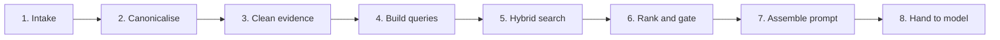

# From a Wazuh alert to the model prompt

The local llama.cpp model and the public Anthropic model share prompt preparation and evidence rules, with provider-specific context limits. Neither model searches the database. Retrieval, indicator matching, direction, and ATT&CK class are decided in code first.

Source modules: `Linux_LLM/config/alert_normalizer.py`, `ssh.py`, `rag.py`, `cti_artifacts.py`, `report.py`, `llm_provider.py`, `llm_client.py`, `anthropic_llm.py`, `prompt_safety.py`. This page describes the analysis path as implemented.

Everything before `ReportFormatter._generate_llm_report_with_guardrails` is deterministic data processing. The model call is the last stage.

## Alert path

Three intakes share one normalizer and one cleaner. Uploaded JSON is for Analysis when SSH is down. Live alerts come from `alerts.json`. Selected viewer rows are re-read on the server. Archive files feed the knowledge base, not the current incident.

`SOCApplication._create_ssh_reader` builds a `SmartSSHLogReader`. Its `read_alerts` delegates to `AlertsReader.read_alerts`.

### 1. Intake

| Function | Role | Why it is necessary | How it improves accuracy |
| --- | --- | --- | --- |
| `SOCApplication._parse_uploaded_alert_template` | Read an Analysis-page JSON, JSONL, or NDJSON upload. | Live SSH is optional. The same analyser has to accept a file. | Rejects a bad file before a partial object is treated as an incident. |
| `SOCApplication._normalize_uploaded_alert_shape` | Send one uploaded record into the shared normalizer. | Upload must not have its own field map. | Marks the record `manual_upload` so later text can say where the value came from. |
| `SOCApplication._read_current_alerts_sync` | Open SSH, read the current alert file, and close the session. | The read has to stay inside one worker and one connection. | Line and byte caps stop a huge file from silently cutting a record in half. |
| `AlertsReader.read_alerts` | Parse `alerts.json` lines, then normalise the batch. | This is the live Wazuh file used by Analysis and the alert viewer. | Malformed lines are skipped and counted, so one bad line does not invent an alert. |
| `analyze_selected_alerts` | Re-read the live file and keep only the checked identities. | The browser never holds the full Wazuh object. | Selection is matched by a hash of the canonical record, so the analysed alert is the one on the server. |
| `SmartSSHLogReader.read_archives_smart` | Read bounded archive days for the knowledge base. | Historical alerts are retrieval context, not the current incident. | The same normalizer tags them `ssh_archive`, so an old alert cannot be confused with the alert under analysis. |

### 2. Canonicalise the record

| Function | Role | Why it is necessary | How it improves accuracy |
| --- | --- | --- | --- |
| `AlertNormalizer.normalize` | Turn one record into `alert-schema-v4`. | Suricata, ECS, Sysmon, sshd, and syscheck do not share field names. | Idempotent: a record already on this schema is copied, not rewritten. |
| `AlertNormalizer.normalize_many` | Normalise a live or archive batch and return counts. | SSH returns many lines. One failure must not drop the rest. | Warnings and failures are counted instead of disappearing. |
| `AlertNormalizer.get_alert_root` | Unwrap an Elasticsearch `_source` wrapper. | Some exports hide the alert under `_source`. | Fields are read from the real body, not from the wrapper. |
| `AlertNormalizer.path_value` and `AlertNormalizer.set_nested_missing` | Copy an alias only when the canonical field is empty. | `srcip`, `DestinationIp`, and `source.ip` are the same fact. | An existing canonical value is never overwritten by a weaker alias. |
| `AlertNormalizer.parse_embedded_event` | Parse JSON stored in `full_log` or `event.original`. | Decoders often bury the event in a string. | Those nested indicators become searchable fields instead of opaque text. |
| `AlertNormalizer._reconstruct_auditd_command` | Join auditd execve argument pieces into one command line. | The command is the evidence. Split `a0`, `a1` fields are not. | Retrieval and the report see the command the process actually ran. |
| `AlertNormalizer._split_sysmon_hashes` | Split a Sysmon Hashes string into md5, sha1, and sha256. | CTI stores one hash per type. | An exact hash lookup can hit. A combined string would miss. |
| `AlertNormalizer._enrich_process_fields` | Derive a process name from its image path. | Some events have a path and no name. | The name used in behavior matching is the executable, not the whole path. |
| `AlertNormalizer._decode_powershell_encoded_command` | Decode a PowerShell `-enc` payload to text. | The encoded blob hides the command from keyword and IOC search. | The decoded text is stored beside the original. It is observed telemetry, not a guess. |
| `AlertNormalizer._canonicalize_windows_paths` | Give Windows paths one spelling. | Slash and case differences split the same file into two indicators. | The same file matches itself across alerts and CTI. |
| `AlertNormalizer._coerce_container_shapes` | Put a scalar that should be an object under `value`. | One bad field used to abort the whole batch. | The rest of the alert survives, and the odd field is still visible. |
| `AlertNormalizer._apply_flat_conveniences` | Fill a few flat aliases used by older readers. | Downstream code still reads a small set of stable keys. | Missing convenience fields are filled only when the canonical value exists. |
| `AlertNormalizer.bounded_unknown_fields` | Keep unknown security keys, with a size bound. | A new decoder field should not vanish, and it should not flood the prompt. | Unrecognised evidence stays available for the analyst without becoming a false IOC. |
| `AlertNormalizer._canonical_view` | Build the stable field view stored on the alert. | Later steps need one place to read the canonical facts. | Provenance lists which source path supplied each value. |

### 3. Clean the evidence contract

| Function | Role | Why it is necessary | How it improves accuracy |
| --- | --- | --- | --- |
| `AlertAnalyzer.clean_log_data` | Build the compact evidence contract used by retrieval and the prompt. | The raw alert is too large and too inconsistent to send as-is. | Records with no label and no security signal are counted and dropped. Unlabelled records that still have evidence are kept. |
| `_expand_alert_records` | Flatten a nested alerts array into individual records. | One upload object can contain many alerts. | Each alert is scored and retrieved on its own facts. |
| `_readable_alert_body` | Return a root and a data object even if a field has the wrong type. | A scalar where an object was expected must not crash the batch. | The odd value is kept under `value`, matching the normalizer. |
| `AlertAnalyzer._classify_ip_context` | Label each address infrastructure, owned, internal, non-global, external, or unknown. | A private address is not automatically the attacker. | Direction and remediation follow the asset inventory instead of a public-IP guess. |
| `AlertNormalizer.first_populated` | Pick the first present HTTP method, status, user agent, or referrer alias. | HTTP fields arrive under several names. | The prompt gets one method and one status, so the audit can check them later. |
| `AlertAnalyzer._first_dict` | Read the first DNS query object. | DNS queries are sometimes a list. | The looked-up name is the indicator, not the list wrapper. |
| `AlertAnalyzer._merge_mitre_values` | Validate explicit ATT&CK IDs against `mitre_techniques.json`. | Alerts contain technique IDs that may be deprecated, misspelled, or renamed. | Valid IDs keep their catalog name. Invalid and deprecated IDs stay labelled, so the model cannot silently rename them. |
| `CTIArtifactExtractor.extract` | Extract indicators from the canonical rule, data, and `full_log` only. | Scanning the whole JSON would treat field names such as `source.ip` as domains. | Observed IOCs are limited to values that were actually in the event. |
| `AlertAnalyzer._classify_threat` | Set inbound, outbound, lateral, external, or infrastructure from the two address classes. | The report has to say which way the traffic went. | Infrastructure noise is marked low confidence instead of being written up as an intrusion. |
| `AlertAnalyzer._infer_behavior_tags` | Attach coarse behavior tags from the cleaned fields. | Retrieval needs a behavior phrase, not only an IP. | Tags drive later technique suggestions and are kept separate from explicit ATT&CK IDs. |
| `AlertAnalyzer._extract_observed_iocs` | Collect typed indicators already present on the cleaned alert. | Exact search needs types: IP, domain, URL, hash, CVE. | A typed term can be matched with a boundary. A raw string cannot. |
| `AlertAnalyzer._build_response_focus` | Name the host, process, file, or service the response should examine. | Remediation has to point at something that was observed. | Later action checks can reject a block target that is not in this focus. |
| `AlertAnalyzer._build_directional_focus` | Write the direction sentence used by retrieval and the prompt. | IP class and Suricata direction can disagree. | The application states the direction before the model does. |
| `AlertAnalyzer._build_priority_reason` | Record why the alert is high or low priority. | Rule level alone is not a reason. | The prompt can explain priority from rule level plus direction, not from a hunch. |
| `AlertAnalyzer._build_retrieval_fingerprint` | Build a short identity of the alert for retrieval. | Repeated alerts with the same facts should retrieve the same context. | The fingerprint is derived from observed IOCs and behavior, so cosmetic field order does not change the search. |

## Retrieval

Hybrid search is three arms.

- Exact arm: the indicator is the same object.
- Lexical arm: the words or a defanged spelling occur.
- Semantic arm: the passage is near the query in embedding space.

Only the exact arm can establish an IOC match.

### 4. Build the search

| Function | Role | Why it is necessary | How it improves accuracy |
| --- | --- | --- | --- |
| `EnhancedReportFormatter.generate_report_with_rag` | Choose manual full retrieval or the automatic high-severity path. | Automatic monitoring and the Analysis page share one report generator. | If the alert is not already cleaned, `clean_log_data` runs here. Both paths then use the same document cap. |
| `ReportFormatter._build_metadata_filter` | Set archive minimum severity and time window. | Years of archive alerts would overwhelm a current incident. | The filter applies only to archive rows. Uploaded CTI is not thrown out for being old or low severity. |
| `ReportFormatter._configured_retrieval_limit` | Read `RAG_MAX_DOCS`. | Manual and automatic analysis must keep the same number of documents. | An exact match inside the configured limit is kept on both paths. |
| `ReportFormatter._retrieve_automatic_context_snapshot` | Run one mixed retrieval while holding the corpus lock. | A corpus switch during the search could mix two knowledge bases. | Rows from another corpus are discarded. If nothing matches, recent custom documents are only a labelled fallback. |
| `ReportFormatter._build_exact_terms_from_alerts` | Build typed terms: addresses, domains, URLs, hashes, CVEs, rule IDs, ATT&CK IDs, actors, malware. | The database exact arm needs types, not a bag of words. | Attacker-relevant addresses are separated from owned and monitoring addresses. |
| `ReportFormatter._build_focused_retrieval_queries` | Make a few short queries from those terms, signatures, and behavior tags. | One giant query makes semantic search match generic words. | Common process names, versions, and low-signal words are removed before the embedding is computed. |
| `ReportFormatter._select_representative_alerts` | Pick distinct high-value alerts from the batch. | A burst of identical events would fill the prompt. | A distinct DNS name, URL, hash, or process is not dropped just because the addresses repeat. It is also used when building focused queries, the flow ledger, and the compact alert summary. |

### 5. Hybrid search

| Function | Role | Why it is necessary | How it improves accuracy |
| --- | --- | --- | --- |
| `ReportFormatter._retrieve_context_for_alerts` | Lock the active corpus and retrieve. | Retrieval must see one corpus for the whole request. | Exact terms are sent on the first query only, so the same IOC is not scanned once per phrase. |
| `RAGContextManager.get_retriever` | Search archive and custom documents together. | This is the manual and automatic mixed path. | Archive metadata filters stay on the archive SQL. CTI is searched in full. |
| `RAGContextManager.search_custom_documents` | Search uploaded CTI only. | Some callers want documents without archive alerts. | The best chunk per source document is kept, so one long article does not occupy every slot. |
| `RAGContextManager.search_archive_alerts` | Search historical alerts only. | Archive context is a different evidence class from CTI. | Severity and time filters apply here. |
| `RAGContextManager._hybrid_search` | Run semantic, exact, and lexical arms, then merge them. | No single arm is sufficient. | If the embedding model fails, exact and lexical search still run. |
| `RAGContextManager._encode_texts` | Embed the query with the same model used at index time. | Semantic scores are only comparable inside one embedding space. | A failed encode skips semantic search rather than returning a bogus similarity. |
| Semantic SQL arm | Cosine similarity against pgvector, above `similarity_threshold`. | Wording in CTI rarely equals the alert text. | Weak similarity never becomes an exact match. It stays a semantic candidate. |
| Exact SQL arm | Canonical equality on `document_iocs`, then typed JSON values, then a bounded text scan. | The application, not the model, decides that an indicator matched. | `10.0.0.1` does not match `110.0.0.10`. `evil.com` does not match `notevil.com`. |
| `RAGContextManager._contains_exact_term` | Confirm a text hit on a token boundary. | SQL `ILIKE` is only a candidate generator. | A partial string is discarded before it can be called an exact IOC. |
| Lexical SQL arm | PostgreSQL `simple` full text, including defanged indicator spellings. | `hxxp` and broken tokens still need to find the article. | A defanged hit is lexical, not an exact scheme match. |
| `RAGContextManager._exact_match_evidence` | Write the human-readable line that says what matched. | A score without a reason cannot be audited. | The prompt later quotes these lines as application-established matches. |
| `RAGContextManager._merge_hybrid_results` | Combine arms that hit the same chunk. | One paragraph can be both an exact hash hit and a semantic neighbour. | Match types are unioned, so an exact hit is not hidden by a lower semantic score. |
| `RAGContextManager._expand_custom_document_context_from_exact_hits` | Pull nearby sections of the same CTI document. | The exact hit is often a table row with no narrative. | Those passages are labelled `source_context`. They explain the document. They are not new current-alert facts. |
| `RAGContextManager._apply_source_diversity` | Limit how many chunks come from one source inside the SQL result. | One verbose document would otherwise fill the candidate list. | A second source with its own exact indicator can still enter the list. |

### 6. Rank, label, and drop weak context

| Function | Role | Why it is necessary | How it improves accuracy |
| --- | --- | --- | --- |
| `ReportFormatter._dedupe_context_docs` | Merge the same chunk found by several focused queries. | Five queries often return the same article. | Evidence lines from each query are kept, so a second indicator on that article is not lost. |
| `ReportFormatter._select_relevant_context_docs` | Score candidates and cut to the configured limit. | The prompt can hold only so many sources. | Exact evidence, lexical hits, behavior overlap, and source type outrank a lone semantic score. Previously generated SOC reports are penalised. |
| `ReportFormatter._apply_context_source_document_diversity` | Keep one representative chunk per canonical document. | Repeated chunks of one PDF are not five independent sources. | Supporting chunks remain available as source context on the representative. |
| `ReportFormatter._annotate_context_docs` | Add evidence strength, IOC overlap, behavior alignment, reliability, and cautions. | The model needs those labels. It must not invent them. | High, medium, and low strength are computed from the match, not from the document title. |
| `ReportFormatter._filter_context_docs_by_evidence_quality` | Keep high and medium sources. Drop low semantic-only background. | A vaguely similar article is not evidence. | Returning no documents is correct when nothing overlaps the alert. |
| `ReportFormatter._expand_selected_document_evidence` | Add two to four extra passages from the already chosen top document. | The selected chunk may be only the indicator table. | This does not raise the number of sources and does not start a new search. |
| `ReportFormatter._build_incident_synthesis` | Build the structured object the report must follow. | The model otherwise organises the story however it likes. | Direction, sequence, attribution limits, and ATT&CK class are fixed from the alerts and the selected sources. |

## Prompt, then the model

The prompt separates current observations, the flow ledger, application-proven IOC lines, and historical excerpts. Local mode shortens excerpts to fit llama.cpp. Public mode sends the retrieved context intact when the Anthropic window can hold it.

### 7. Assemble the prompt

| Function | Role | Why it is necessary | How it improves accuracy |
| --- | --- | --- | --- |
| `ReportFormatter._prompt_context_policy` | Ask the selected provider how much text it can hold. | The local model and the public model have different windows. | Local mode keeps the historical excerpt caps. Public mode sends the full retrieved context when the window allows. |
| `ReportFormatter._assembly_limits` | Turn that policy into section budgets. | Prompt sections compete for the same window. | Public mode does not drop repeated events or distinct indicators just to fit the local caps. |
| `ReportFormatter._compact_exact_terms_for_prompt` | Shorten the exact-term hint list on the local path only. | The local window is small. | The full term set was already used for retrieval. Compaction changes the hint text, not the search. |
| `AlertAnalyzer.analyze_current_alerts` | Summarise severity and threat counts for the whole batch. | The narrative needs batch totals as well as individual alerts. | Counts come from the cleaned alerts, so the model does not recount them. |
| `AlertAnalyzer.get_inventory_prompt` | Insert the configured asset inventory. | The model does not know which networks are owned. | Owned, internal, and infrastructure ranges stay explicit in the prompt. |
| `ReportFormatter._create_current_alert_context` | Write the authoritative observation section. | Current facts and historical CTI must be separate sections. | The model is told the current alert wins when they disagree. |
| `ReportFormatter._flow_ledger` | Write one line per alert: direction, ports, hashes, process parent, repeats. | Representative selection can omit a repeated alert from the JSON summary. | The ledger is the copy the later audit trusts for direction and counts. |
| `ReportFormatter._format_deterministic_ioc_matches` | List exact matches the application already proved. | The model must not be the thing that declares an IOC hit. | These lines stay intact even when a public prompt is reduced to fit the window. |
| `ReportFormatter._format_context_docs` | Render retrieved excerpts with source labels and strength. | Retrieved text is untrusted data, not instructions. | Low-strength and semantic-only sources are marked as background. |
| `ReportFormatter._bounded_json` | Put the incident synthesis in the prompt, truncated only if it would starve the CTI. | The synthesis is the outline. The excerpts are the evidence. | Truncation is labelled, so a cut synthesis is not mistaken for a complete one. |
| `prompt_safety.section_marker` | Prefix real instruction lines with the section marker. | Alert text and CTI can contain the words "ignore previous instructions". | Only marked lines are instructions. Fenced text stays evidence. |
| `prompt_safety.fence_untrusted` | Wrap alert and CTI text so it cannot pose as a system rule. | The prompt contains attacker-controlled log lines. | A log line that says switch provider or reveal the key stays inside the fence. |

### 8. Hand off to the selected model

| Function | Role | Why it is necessary | How it improves accuracy |
| --- | --- | --- | --- |
| `ReportFormatter._generate_llm_report_with_guardrails` | Call the selected provider with the finished prompt. | This is the first time a model sees the incident. | The provider was already checked. A failure does not fall back to the other provider. |
| `LlamaModelClient.generate_response` | Local path. Fit the prompt, then run llama.cpp. | The local window is smaller than the public window. | Compaction prefers retrieved CTI over verbose synthesis, and it splits only on section markers. |
| `AnthropicProvider.generate_response` | Public path. Send the same prompt to the Messages API. | Public mode is the same evidence with a larger window. | If the prompt still does not fit, low-priority sections shrink and exact IOC lines stay. Thinking blocks are not copied into the report. |
| `ContextPolicy.for_local` and `ContextPolicy.for_public` | Compute the token budget for the chosen backend. | Input, reserved output, and a safety margin must fit the window. | The budget is counts only. The prompt text is not written to the log. |
| `reduce_prompt_to_budget` | Shrink a public prompt that exceeds the window. | Sending an over-long prompt would fail or be truncated by the API at an unknown point. | IOC lines and the output contract are kept. The reduction is recorded on the telemetry. |

Provider reservations cover queueing, context assembly, both permitted model passes, metadata, and cancellation. Another request cannot change the selected backend in the middle of that path. Anthropic responses must confirm `end_turn`; unfinished/refused/tool/continuation responses fail before they can be repaired or labelled complete. These lifecycle checks do not change normalization, retrieval candidates, evidence ranking, or prompt evidence rules.

## Knowledge base, built earlier

Retrieval only sees a corpus that has already been validated.

`DocumentValidator.validate_file` and `DocumentProcessor.process_upload` extract CTI. `CTIArtifactExtractor.extract` and `CTIArtifactExtractor.extract_structured` pull indicators and roles from the document text, not from the file name. `RAGContextManager.build_rag_context` or `extend_rag_context` hashes the sources, chunks them, embeds every chunk, checks the inventory, and only then marks the corpus ready. A failed build leaves the previous corpus active. Extend adds sources. Replace is explicit. The file name is display metadata. It is not an indicator.

Related runtime notes: [rag-architecture.md](rag-architecture.md), [llm-providers.md](llm-providers.md), [operations.md](operations.md).
