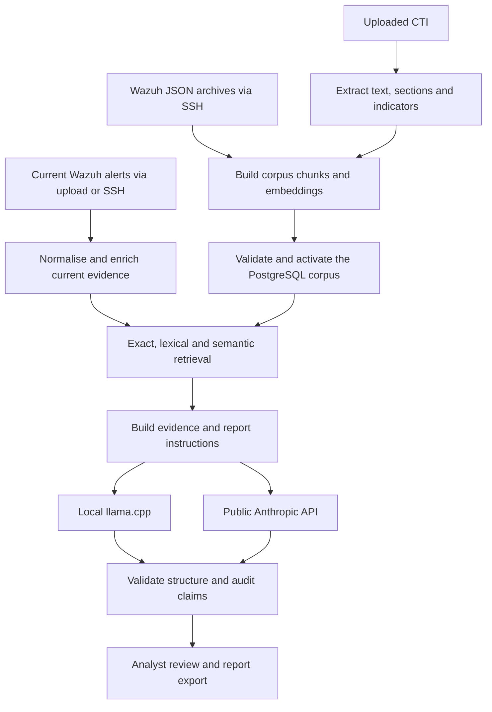

# RAG architecture and alert analysis

The application maintains a versioned knowledge base and uses it to build evidence for each report. `SOCApplication` wires the dashboard and jobs to `ReportGenerator`, which owns corpus management, alert analysis and report formatting. [Application entry point](../Linux_LLM/config/main.py) · [Report pipeline](../Linux_LLM/config/report.py)

## Knowledge base ingestion

An administrator submits CTI uploads, Wazuh archives, or both through **Knowledge base**. The request is checked against file-count and byte limits. Wazuh archive ingestion reads bounded UTF-8 JSON records and streams gzip input without extracting files into the checkout. Malformed archive records, read errors, and exceeded limits abort the build. Missing daily files are handled as absent days. [Document validation](../Linux_LLM/config/rag.py) · [Wazuh readers](../Linux_LLM/config/ssh.py) · [Input limits](operations.md#input-and-resource-limits)

| CTI upload formats | Per-file limit |
| --- | --- |
| `.pdf` | 25 MiB |
| `.docx` | 10 MiB |
| `.txt`, `.md`, `.markdown`, `.html`, `.htm`, `.csv`, `.tsv`, `.json`, `.stix`, `.yaml`, `.yml`, `.xml` | 5 MiB |

- The format-specific processors preserve useful structure such as headings, tables or structured CTI fields. PDF extraction starts with PyMuPDF and can try pypdf when extraction fails or yields poor text. Scanned pages need an OCR text layer or a separate text export. ZIP and TAR uploads are outside the supported format list.
- `CTIArtifactExtractor` extracts typed indicators, actors, malware, techniques, and other relevant entities using generic rules. Structured STIX data can provide relationships and indicator metadata. Section, role, and disposition annotations help the analyser distinguish attacker infrastructure from victim, benign, analysis-environment and reference artifacts.
- `RAGContextManager` represents each archive record as a searchable historical chunk. Custom documents produce section-aware chunks and can produce an artifact summary. Filenames are display and provenance metadata. Uploaded-byte hashes support source deduplication, while canonical document hashes group passages from equivalent source text.
- SentenceTransformers embeds the passage body. Artifact metadata and headers support indicator indexing, lexical search and report context. Queries use the configured query instruction. The resident encoder handles queries and small batches. Bulk passes can use compatible CUDA devices, with worker-level batch reduction on CUDA out-of-memory errors and CPU fallback at single-input size. Committed vectors for an incomplete target can be reused when the same build resumes. [Artifact extraction](../Linux_LLM/config/cti_artifacts.py) · [Embedding runtime](../Linux_LLM/config/embedding_runtime.py) · [Embedding settings](operations.md#database-and-retrieval)

### Corpus activation

**Extend** builds the union of the current custom documents and archive records with the new sources. An identical source already present in the active manifest is skipped. **Replace** uses the selected sources and requires confirmation. Extending an incompatible or invalid active corpus is rejected. Rebuild from the authoritative source set when a version mismatch or legacy manifest prevents safe extension.

Corpus IDs depend on source hashes and the versions of relevant schema, extraction, embedding and chunking inputs. The current retrieval index version is `hybrid-canonical-v4`. A build validates the source inventory and chunk completeness before marking its namespace ready and changing the active pointer. A failed build leaves the prior active corpus selected. Retrieval scopes its reads to an active-corpus snapshot so it can finish consistently during an activation.

| PostgreSQL table | Stored data |
| --- | --- |
| `alert_embeddings` | Historical Wazuh chunks and embeddings |
| `custom_documents` | Uploaded CTI and indexed report chunks, metadata and embeddings |
| `document_iocs` | Typed canonical indicators for exact lookup |
| `rag_corpora` | Build state, version manifests and inventory counts |
| `rag_runtime_state` | Active corpus ID and other runtime state such as vector index metadata |

**Overview** surfaces corpus readiness. The signed-in `/rag-status` endpoint exposes the active ID, version compatibility, counts and a bounded list of recent corpus summaries. Use the host maintenance method `RAGContextManager.activate_corpus()` to validate and select a previously built corpus. [Backup and recovery](operations.md#backup-and-recovery)

## Current alert intake

`AlertNormalizer` maps manual uploads and SSH alerts to the shared `alert-schema-v4` representation. The upload parser accepts UTF-8 JSON, including a BOM, and newline-delimited JSON. Supported shapes include one object, a list of objects, an `alerts` or `affected_items` list, and `data.affected_items`. The normaliser can unwrap Elasticsearch `_source`, map ECS, Suricata and Windows event fields, and extract bounded embedded event data. It retains raw evidence and the provenance of canonical values. [Upload parser and routes](../Linux_LLM/config/main.py) · [Alert normaliser](../Linux_LLM/config/alert_normalizer.py)

`AlertAnalyzer.clean_log_data()` assembles the current-alert evidence used by retrieval, prompting and audit. It collects available rule, agent, network, application, process, file and vulnerability details. Asset classification informs traffic direction and response focus. Optional local GeoIP enriches eligible external addresses. Explicit ATT&CK IDs are checked against the bundled technique catalogue. [Asset and GeoIP settings](operations.md#geoip-and-asset-inventory) · [ATT&CK catalogue](../Linux_LLM/config/mitre_techniques.json)

The Alert viewer uses summary fields and a stable record identity. The server re-reads the alert file for checked rows. Manual uploads and selected-alert jobs enter the analysis queue. The persisted queue ledger contains job status and metadata, while alert payloads and review drafts live in process memory. [Analysis queue](../Linux_LLM/config/analysis_queue.py)

## Hybrid retrieval

`ReportFormatter` builds typed search terms and focused queries from observed indicators, rule and signature text, and behaviour. Automatic and manual analysis share the configured source limit. Time and severity filters used for archive retrieval apply to historical alerts.

| Candidate source | How it works |
| --- | --- |
| Exact match | Looks up typed canonical values in `document_iocs` and structured metadata. Bounded text candidates are checked for full-token matches. |
| Lexical match | Uses PostgreSQL full-text search with the `simple` dictionary. Query construction can include alternate indicator spellings. |
| Semantic match | Uses cosine similarity over pgvector and the configured candidate floor. The exact and lexical arms can continue if query encoding fails. |

Failed SQL arms roll back to a savepoint. The retriever merges match types across arms, then the formatter scores candidates using exact overlap, lexical and semantic signals, behaviour, source type and reliability. Canonical grouping keeps repeated chunks from crowding out distinct sources. Evidence-quality filtering retains high- or medium-strength sources and can return an empty context. Supporting passages from an already selected source can provide surrounding context while keeping the same source identity. [Retrieval and ranking implementation](../Linux_LLM/config/report.py)

## Prompt and report validation

The shared prompt contains alert evidence, a per-alert flow ledger, asset scope, application-established exact matches, historical excerpts with evidence labels, and report instructions. Untrusted evidence is fenced. Context fitting depends on the provider. [Prompt handling](../Linux_LLM/config/prompt_safety.py) · [Provider context limits](llm-providers.md#context-and-completion)

The report distinguishes ATT&CK techniques present in current telemetry, techniques inferred from current behaviour, and techniques found only in historical sources. Named attribution requires supporting CTI and relevant current evidence. Weak or conflicting attribution is qualified or omitted. Historical evidence can inform hunting, while containment and remediation recommendations are checked against observed targets.

The formatter validates the report structure and can make one repair generation pass for an invalid draft. An unusable draft can lead to a deterministic or analyst-review-required report. The claim audit checks direction, execution and exfiltration claims, attribution, technique evidence and action targets. Provider errors follow their own failure path. Review the current telemetry and cited excerpts before using a report to decide on action.

## Review, export and feedback

`ReportParser` supports the Markdown-to-editor round trip, including rich sections, appendices, evidence classes and analyst ATT&CK edits. Approval validates and saves Markdown. Admin approvals can also add a cleaned report to the corpus as historical context. Analyst approvals save the report without indexing it. An indexing failure leaves the approved Markdown available.

Use **Download PDF** in **Reports** to render a selected report with WeasyPrint. Rendering permits eligible local report assets, including generated charts. The renderer caps its Markdown input at 5 MiB and each eligible local resource at 20 MiB. [Report parser](../Linux_LLM/config/report_parser.py) · [PDF converter](../Linux_LLM/config/pdf_converter.py)
